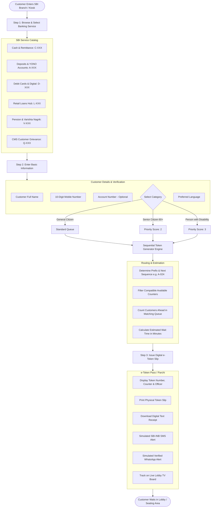
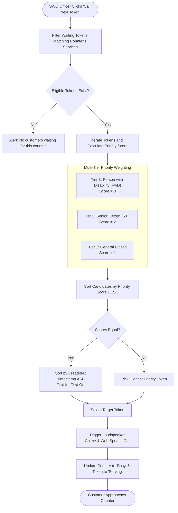
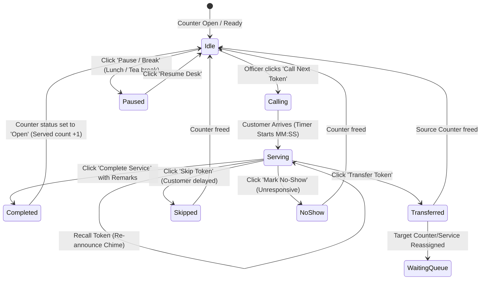
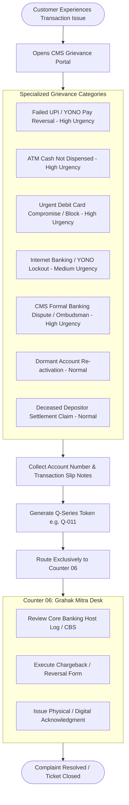
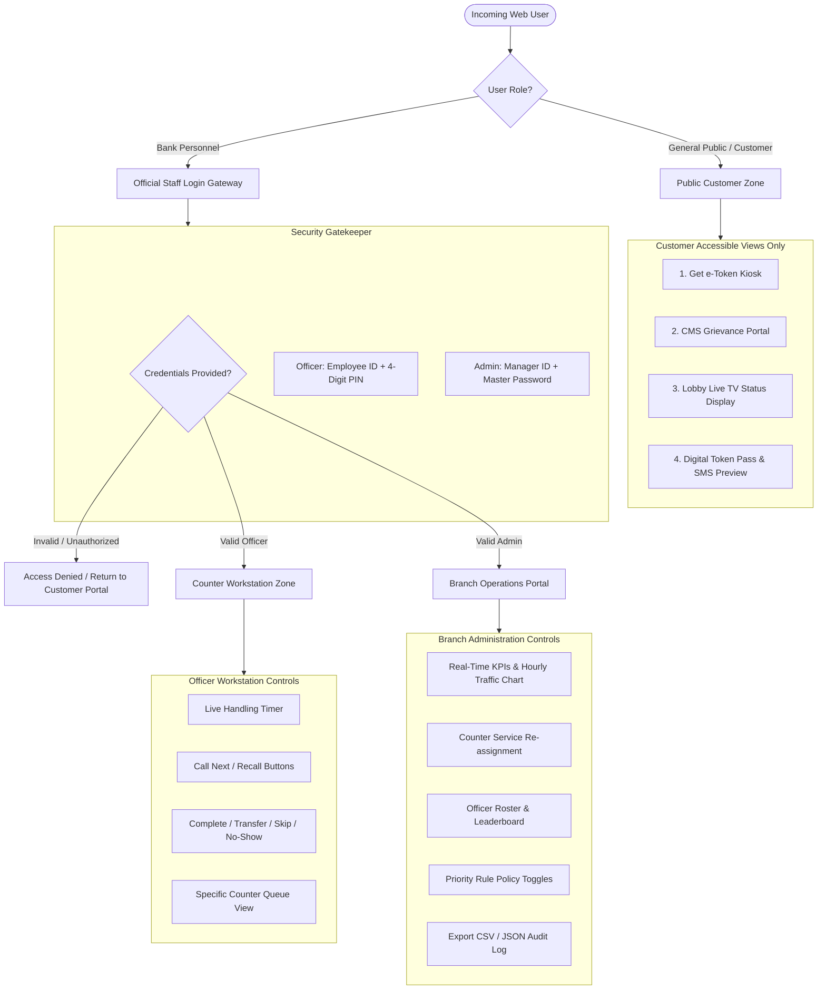
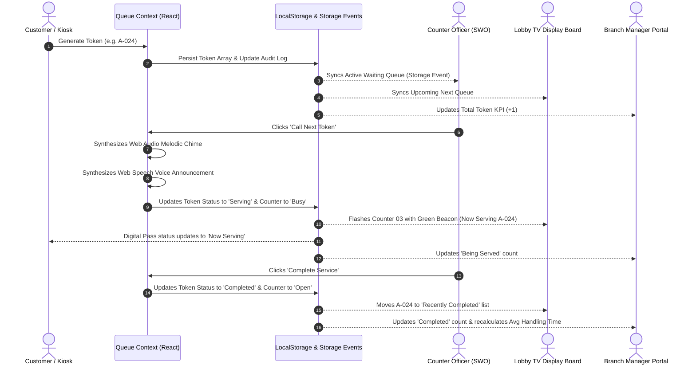

# State Bank of India — Smart Queue Management System (QMS)
## System Architecture & Process Flowcharts (`doc.md`)

This document provides visual flowcharts explaining the end-to-end working of the SBI Branch Queue Management System, the priority queue algorithm, the SWO officer counter lifecycle, the CMS grievance routing, and the role-based security separation.

---

## 1. Customer e-Token Generation Flowchart

This flowchart illustrates the 3-step self-service flow for a customer entering an SBI branch kiosk or visiting the portal on their smartphone.

---

## 2. Priority-First Queue Sorting Algorithm

SBI provides dedicated fast-track attention to senior citizens (*Varishta Nagrik*) and persons with disabilities (*Divyangjan*). This flowchart illustrates how tokens are ranked when a counter officer clicks **Call Next Token**.

---

## 3. SWO Officer Workstation Lifecycle State Machine

This flowchart demonstrates the complete operational lifecycle of a Single Window Operator (SWO) managing customers at a bank counter.

---

## 4. CMS Grievance Redressal Flowchart (Failed UPI / ATM Discrepancies)

Transactions requiring technical dispute redressal bypass standard queues and route directly to **Counter 06 (Grahak Mitra & Grievance Redressal Lead)**.

---

## 5. Role-Based Security & Separation Architecture

This flowchart illustrates the strict architectural boundary preventing public customers from accessing administrative controls or officer workstations.

---

## 6. Real-Time Data & Cross-Tab Synchronization Flow

This flowchart shows how state mutations (e.g., token generation, officer calls) automatically sync across customer phones, branch kiosks, and lobby TV screens.

---
*State Bank of India — Smart Queue Management System (QMS) Architecture Manual 2026*
